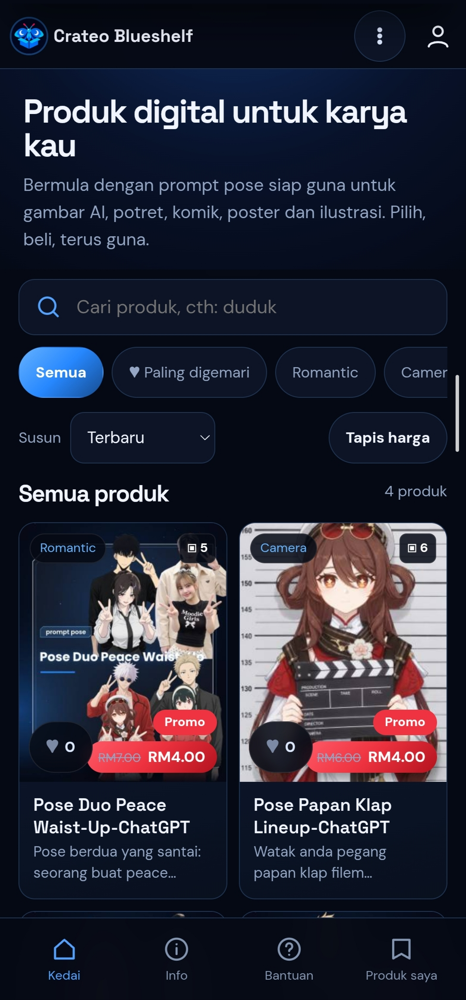
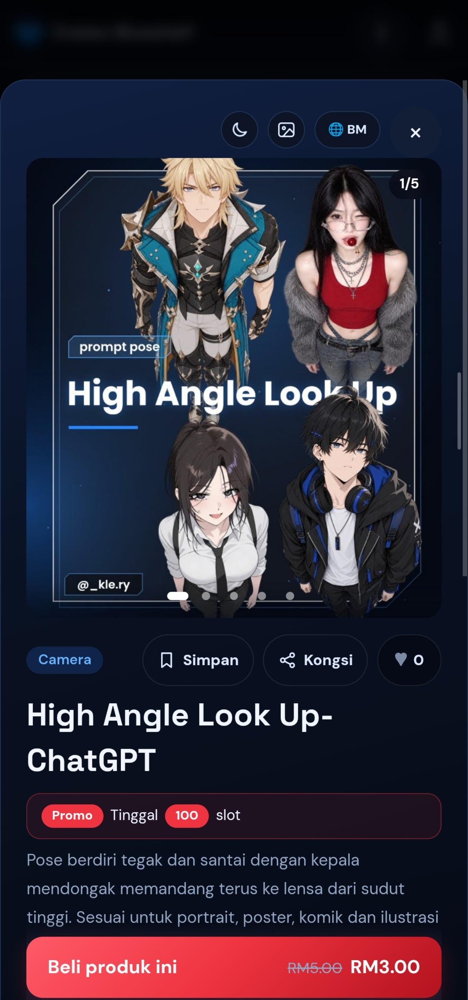
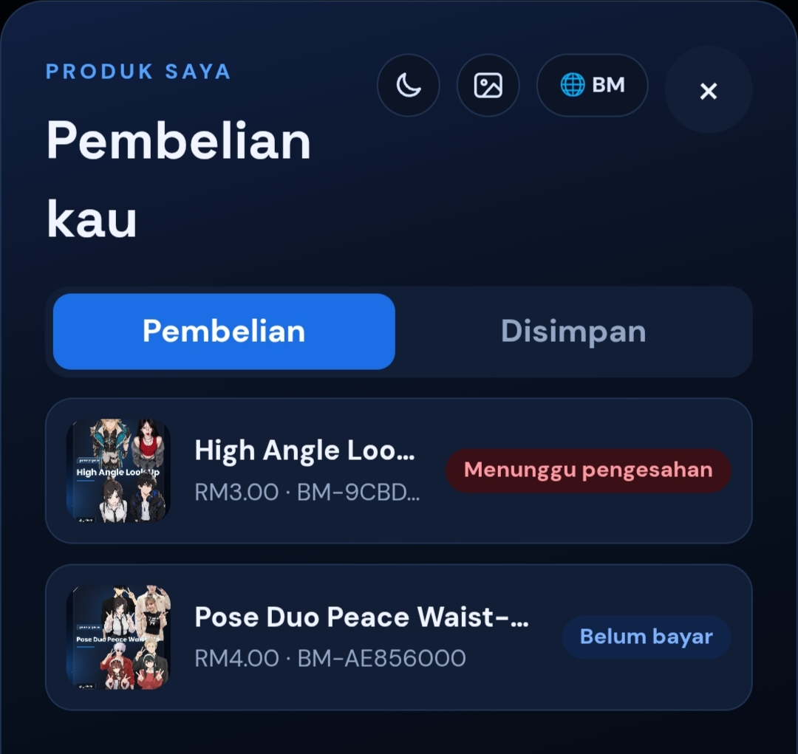
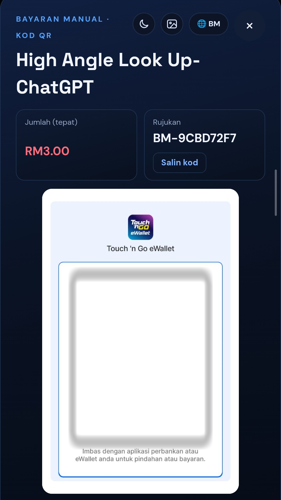
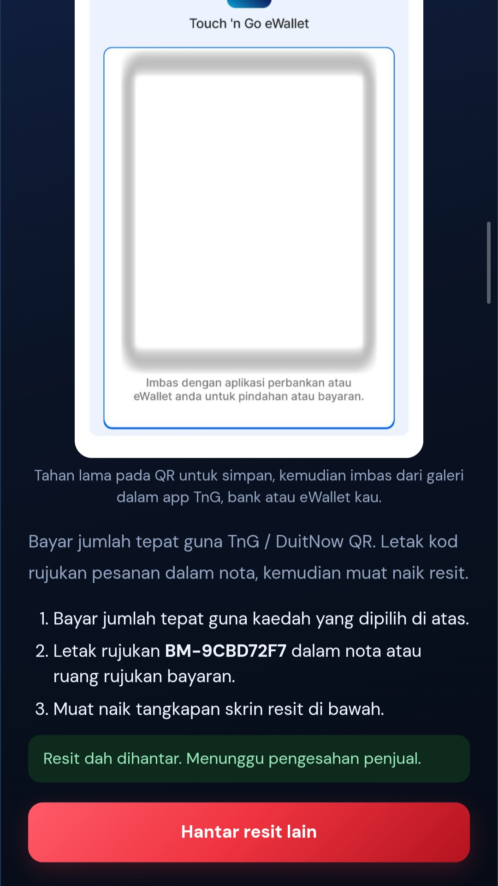
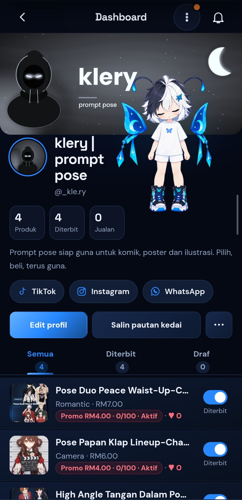
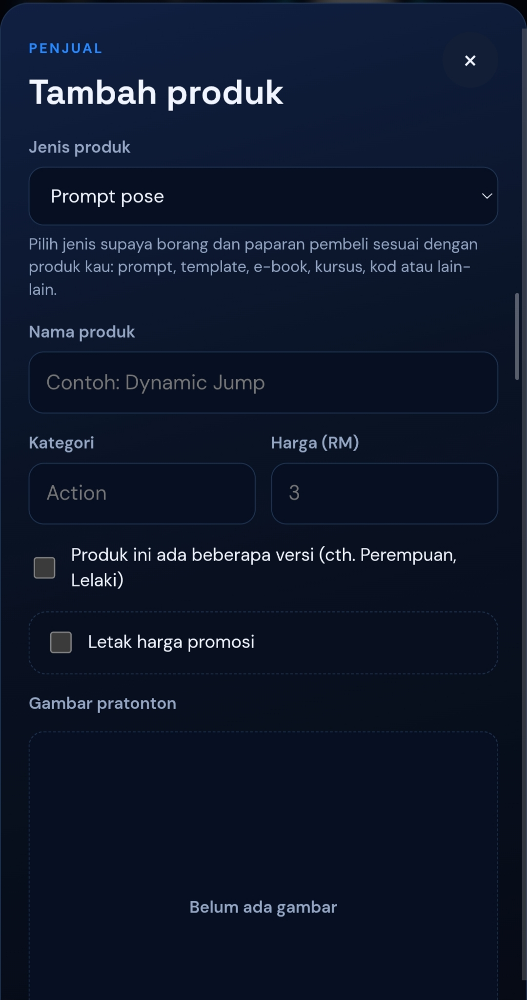
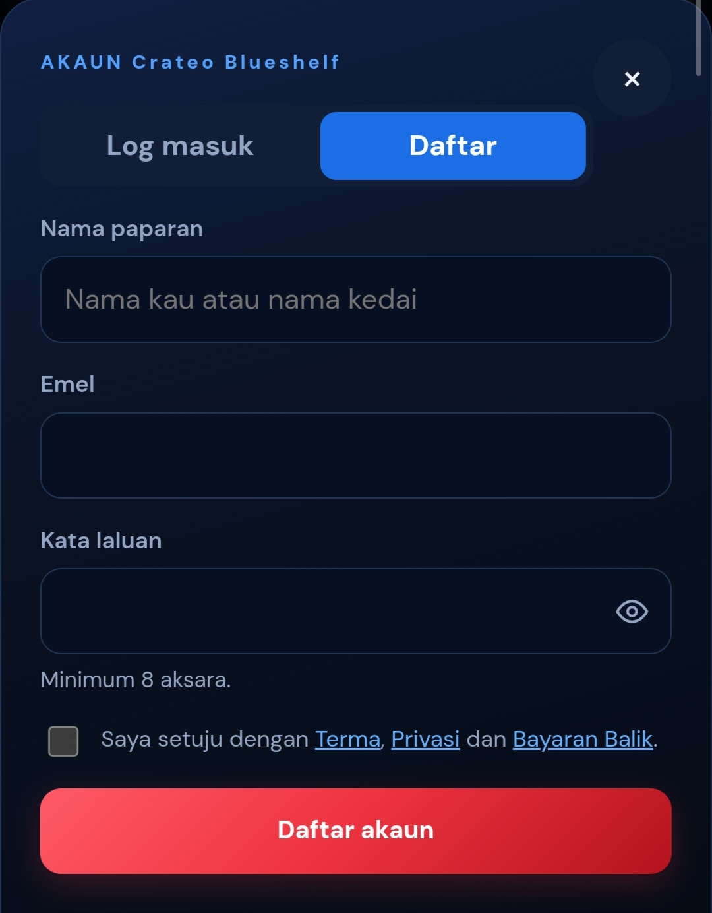
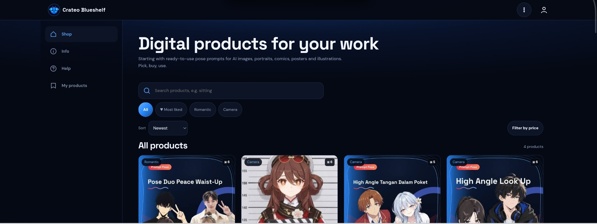

# Crateo Blueshelf

**Pilih, beli, terus guna.**

Crateo Blueshelf ialah aplikasi web progresif (PWA) untuk kedai produk digital. Fokus awalnya ialah prompt pose siap guna untuk projek AI art, Original Character (OC), potret, komik, poster dan ilustrasi.

**Demo:** <https://crateo-blueshelf.netlify.app>

> **Status: beta awal.** Projek ini masih dalam pembangunan dan ujian. Kehadiran sesuatu ciri dalam kod atau screenshot tidak bermakna ia sudah diuji sepenuhnya. Lihat bahagian [Status pembangunan](#status-pembangunan).

---

## Screenshot

Semua screenshot diambil daripada aplikasi sebenar (data ujian). Kod QR pembayaran telah dikaburkan.

### Pembeli (telefon)

| Katalog | Butiran produk | Pembelian saya |
| :---: | :---: | :---: |
|  |  |  |
| Carian, kategori, susunan dan harga promo | Galeri pratonton, promo dan butang beli | Status "Belum bayar" dan "Menunggu pengesahan" |

### Bayaran manual

| Bayar dengan QR | Resit dihantar |
| :---: | :---: |
|  |  |
| Jumlah tepat dan kod rujukan pesanan | Langkah bayar, muat naik resit, tunggu pengesahan penjual |

### Penjual dan akaun

| Dashboard penjual | Tambah produk | Daftar akaun |
| :---: | :---: | :---: |
|  |  |  |
| Profil kedai, status terbit dan promo | Jenis produk, versi, promosi dan gambar | Borang pendaftaran dengan persetujuan terma |

### Desktop

Paparan desktop menggunakan sidebar kiri dan grid produk (antaramuka dalam English kerana bahasa peranti ujian).

---

## Ciri utama

Ciri di bawah wujud dalam build semasa (v11.1). Status pengujian dinyatakan dalam bahagian seterusnya.

**Untuk pembeli**
- Katalog produk dengan carian, kategori, susunan (terbaru, termurah, termahal, paling disuka, terlaris) dan tapis harga.
- Butiran produk dengan galeri gambar, lightbox zum, penerangan dan harga dalam RM.
- Daftar akaun, log masuk, lupa/tukar kata laluan dan CAPTCHA.
- Pesanan, status pesanan, resit dan senarai "Produk saya".
- Bayaran manual melalui kod QR, bank atau eWallet milik penjual, serta produk percuma.
- Suka, ikut penjual, simpan produk dan blok penjual.
- Kongsi produk, lapor produk atau kedai, dan borang maklum balas.

**Untuk penjual**
- Dashboard penjual: tambah/edit produk, terbit atau draf, senarai pesanan dan jualan.
- Profil kedai: nama, @handle, bio, banner, gambar profil dan pautan sosial.
- Beberapa versi dalam satu produk, harga promosi, dan jenis produk (pose, prompt, template, ebook, course, software, lain-lain).
- Analitik agregat (tontonan, kongsi, suka, jualan dibayar).
- Penjual baharu memerlukan kelulusan owner sebelum produk pertama diterbitkan.

**Umum**
- Dwibahasa: Bahasa Melayu dan English.
- Mod gelap (lalai) dan mod terang.
- Maskot Blue.
- PWA: manifest, service worker dan panduan pemasangan. Ikon aplikasi telah dilihat dipasang pada skrin utama Android dan sebagai aplikasi di Windows.
- Susun atur responsif untuk telefon dan desktop.
- Panel Owner untuk permohonan penjual, pengumuman dan tetapan awam.
- Ciri Komuniti (suapan karya, komen, laporan) wujud dalam kod tetapi **dimatikan secara lalai** dan hanya untuk beta jemputan.

## Pengguna sasaran

- Pencipta AI art dan ilustrasi.
- Pencipta Original Character (OC).
- Pelukis komik dan pembuat poster.
- Pencipta serta penjual prompt.
- Penguji awal yang ingin memberikan maklum balas.

## Teknologi

Berdasarkan kod sebenar dalam repositori ini:

| Bahagian | Teknologi |
| --- | --- |
| Frontend | HTML, CSS dan JavaScript vanila (tanpa langkah binaan) |
| Backend | [Supabase](https://supabase.com): Auth, Postgres dengan Row Level Security, Storage, RPC |
| Hos | [Netlify](https://www.netlify.com) (laman statik) dengan fail `_headers` |
| Fungsi serverless | Netlify Function (`og`) untuk pratonton pautan kongsi |
| PWA | `manifest.json` dan `sw.js` |
| Fon | Google Fonts (DM Sans, Space Grotesk) |

Gateway bayaran ToyyibPay sudah dikod tetapi **dimatikan**. Bayaran manual ialah kaedah asas.

## Status pembangunan

- Aplikasi demo boleh diakses dan digunakan untuk meneroka antaramuka.
- Kebanyakan ciri wujud dalam build, tetapi tidak semuanya telah diuji pada pangkalan data dan akaun sebenar.
- Beberapa ciri memerlukan skrip SQL Supabase (`supabase_v*.sql`) dijalankan terlebih dahulu. Tanpa skrip tersebut, ciri berkenaan tersembunyi atau terhad.

### Perlu pengujian lanjut

- Aliran pesanan dan kelulusan bayaran daripada pembeli hingga penjual.
- Kebenaran akses (RLS) dan pemisahan data antara pembeli, penjual dan owner.
- Ikut/simpan/blok penjual, analitik dan promosi pada pangkalan data sebenar.
- Muat turun lampiran fail selepas pembayaran disahkan.
- Pratonton pautan kongsi, notifikasi push dan pemasangan PWA pada pelbagai peranti.
- Ciri Komuniti (masih beta jemputan).

## Keselamatan dan privasi

- Tiada kata laluan, token atau maklumat pengesahan disertakan dalam dokumentasi.
- Screenshot pembayaran telah disunting atau dipotong supaya kod QR sebenar dan nama peribadi tidak terdedah.
- **Aplikasi ini belum diisytiharkan sedia untuk transaksi sebenar.** Keselamatan backend dan aliran pembayaran belum disahkan melalui ujian menyeluruh.
- Jangan masukkan maklumat peribadi atau pembayaran sebenar semasa menguji demo.

## Maklum balas

Maklum balas amat dialu-alukan, terutamanya tentang:

- Kejelasan antaramuka dan aliran penggunaan.
- Pepijat atau paparan yang tidak betul pada telefon atau desktop.
- Cadangan jenis produk atau ciri baharu.

Sila buka [Issue](../../issues) di repositori ini, atau gunakan borang maklum balas dalam aplikasi demo.

## Matlamat projek

Menyediakan kedai produk digital yang mudah digunakan oleh pencipta, bermula dengan prompt pose, dan berkembang kepada lebih banyak jenis produk serta komuniti kreator secara berperingkat.

---

*Crateo Blueshelf — Pilih, beli, terus guna.*
